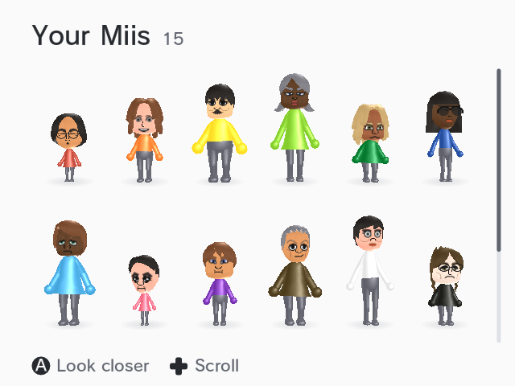
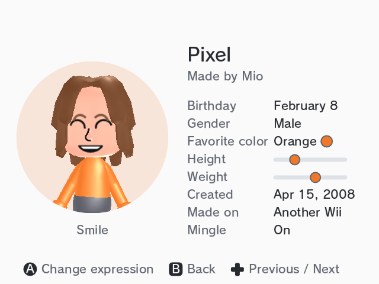

# MiiKit

MiiKit is a C library for Wii homebrew that reads, changes and draws Miis, as the Wii's own Mii library (RFL) does for games. It draws a Mii with GX from the Wii's own face models and bodies, which it can read straight from the NAND, so an app doesn't need anything on the SD card first. [MiiKit Demo](https://github.com/cmyksoda/MiiKit-Demo) uses it to show every Mii on a Wii in 3D.





MiiKit started as sdk/mii in [hbc-reborn](https://github.com/Monsterray/hbc-reborn), a maintained fork of the Homebrew Channel, and this repository keeps its history. The NAND loader (`miinand.c`) was added here.

## Files

| File | What it does |
| --- | --- |
| `mii.h`, `mii.c` | The 74-byte Mii, checked as the Wii checks it. New and random Miis, `.mii` files, the Mii database (`RFL_DB.dat`) with its hidden Miis, and a Wii Remote's 10 Miis |
| `miidraw.h`, `miidraw.c` | Draws a Mii with GX: the head as the Wii draws it, its face in seven expressions, and a body |
| `miibody.c` | The Mii Channel's own bodies, skinned on the GPU, with their animations |
| `miifx.c` | The Mii Channel's particle effects |
| `miinand.c` | Reads the face models and bodies from the Wii's NAND |

Copy the files you need into your project. [example/](example) is a whole program that uses `mii.c`.

## Building

- Compile the files as C, and link with `-lwiiuse -lbte -logc -lm`, in that order.
- MiiKit builds with devkitPro's libogc 3 and with libogc2.
- With `-DMII_NO_OGC`, everything but the drawing builds on a PC, for tools and tests.

## Reading Miis

A call that fails returns a negative `MII_E_*` code, and `mii_strerror()` names it.

```c
mii_db db = { 0 };
mii m;
char name[MII_NAME_UTF8_MAX];

int r = mii_db_load(&db);      // MII_E_NO_FILE: the Mii Channel has never been opened
if (r < 0) {
    printf("%s\n", mii_strerror(r));
    return;
}
for (int i = 0; i < MII_DB_SLOTS; ++i)
    if (mii_db_get(&db, i, &m) == MII_OK) {
        mii_get_name(m.name, name, sizeof(name));
        printf("%d: %s, likes %s\n", i, name, mii_color_name(m.fav_color));
    }
mii_db_free(&db);
```

Adding, changing and exporting Miis, a Wii Remote's Miis, and what each error means are in [docs/miis.md](docs/miis.md).

## Drawing a Mii

```c
static mii_res res;
static mii_model model;
static mii_body male, female;
mii m;

/* Once, outside the frame loop. */
if (mii_res_load_nand(&res) < 0 && mii_res_load(&res, NULL) < 0)
    return;                                        // no face models
int bodies = mii_bodies_load_nand(&male, &female) == MII_OK;
if (mii_get(0, &m) == MII_OK && mii_model_make(&res, &m, 128, &model) == MII_OK && bodies)
    mii_model_set_body(&model, m.sex == MII_FEMALE ? &female : &male);
mii_res_free(&res);                                // the model keeps what it needs

/* Each frame: a viewport where the Mii stands, a camera that frames it, then the Mii. */
Mtx44 proj;
Mtx view;
mii_pose pose = { 0 };                             // all zero stands still
GX_SetViewport(x, y, 128, 208, 0, 1);
mii_view(&model, &pose, 128.0f / 208, 0.04f, proj, view);
GX_LoadProjectionMtx(proj, GX_PERSPECTIVE);
mii_draw(&model, &pose, view, NULL);
```

- **Reading from the NAND needs AHBPROT:** `<ahb_access/>` in your `meta.xml`, and no IOS reload before the call. IOS refuses these files to apps, so `miinand.c` lifts its check for the read and then puts back exactly what it changed. Without AHBPROT the calls return `MII_E_DENIED`, and `mii_res_load(&res, NULL)` reads a copy at `sd:/mii/RFL_Res.dat` instead, which hbc-reborn's Save Mii faces makes.
- **Stills:** `mii_capture()` draws a Mii into a texture, and `mii_icon()` draws a head icon framed as the Wii Menu frames it. Both use a corner of the EFB, so call them between frames, then set your GX state again. Call `GX_DrawDone()` before the CPU reads the texture.
- **Keep your GX FIFO in MEM1,** as a static array. A GPU fed its commands from MEM2 stalled at random on a real Wii.
- **In Dolphin,** the CPU sees a captured texture as zeros unless Graphics > Hacks > "Store EFB Copies to Texture Only" is off.

Animations, effects, crowds of Miis and the rest are in [docs/drawing.md](docs/drawing.md), and `miidraw.h` documents every call.

## Credits

- **sdk/mii**, by the hbc-reborn developers: all of MiiKit but the NAND loader
- **The NAND loader** (`miinand.c`), by cmyksoda
- The CC0 decompilations of RFL, for the numbers the heads are drawn with ([mii-rendering.md](https://github.com/Monsterray/hbc-reborn/blob/master/docs/research/mii-rendering.md) in hbc-reborn lists the sources)

## License

MiiKit is in the public domain, under [CC0 1.0](LICENSE).

MiiKit isn't affiliated with Nintendo.

---

*This project was made with AI assistance. For more information, see [my AI usage statement](https://github.com/cmyksoda/cmyksoda/blob/main/AI_USAGE.md).*
